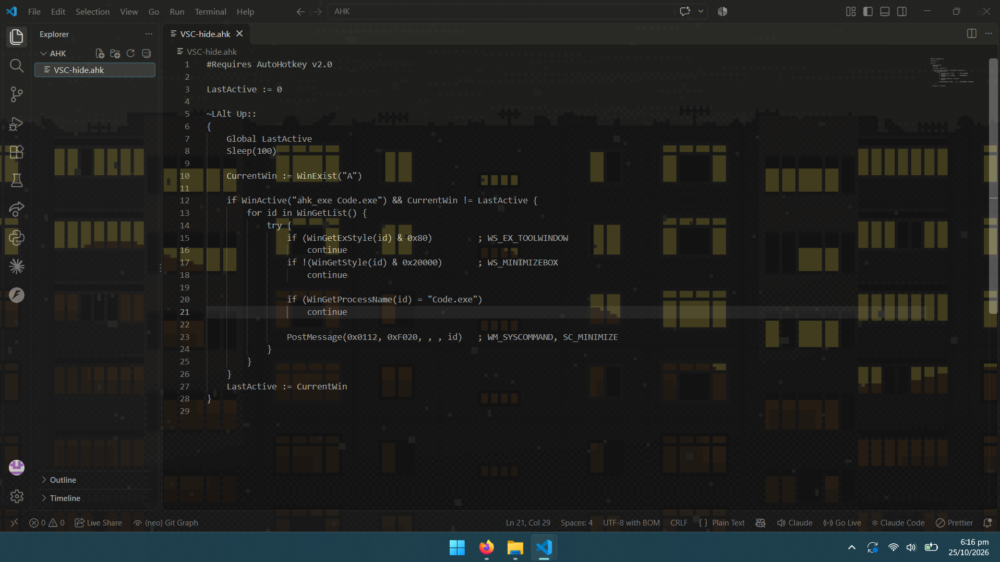

# VSC-hide

This script is to make the desktop wallpaper the VS Code's background using [GlassIt-VSC](https://marketplace.visualstudio.com/items?itemName=s-nlf-fh.glassit) by minimising all other windows when I alt-tab back into VS Code.

