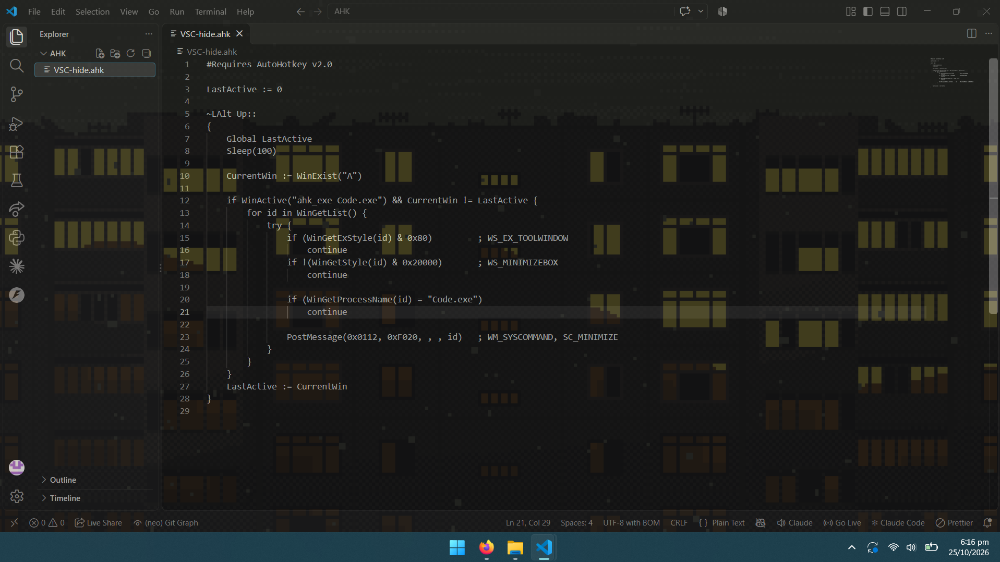

# VSC-hide

This script is to make the desktop wallpaper the VS Code's background using [GlassIt-VSC](https://marketplace.visualstudio.com/items?itemName=s-nlf-fh.glassit) by minimising all other windows when I alt-tab back into VS Code.

The wallpapers are from [Wallpaper Engine](https://store.steampowered.com/app/431960/Wallpaper_Engine/).

# CallMode

When you are screen sharing, this script makes VS Code opaque and stops Wallpaper Engine so nobody sees the wallpaper. Everything goes back to normal a few seconds after the share ends.

It counts as screen sharing when:

- a Chromium browser (Chrome, Edge, Brave etc) shows its "is sharing your screen" bar
- a Firefox-based browser shows its sharing indicator
- Teams opens its compact meeting view (shown while sharing)
- Zoom shows its floating meeting toolbar(UNTESTED)

More apps can be added to `ShareWindows` in `CallMode.ahk` using the window title or class from AutoHotkey's Window Spy.

During a share, `glassit.alpha` is set to `255` in VS Code's `settings.json` and applied to the open VS Code windows. The previous value is restored afterwards.

Wallpaper Engine is paused with its `-control stop` command and resumed with `-control play`, so it doesn't show the crash / Safe Start prompt. If it isn't running, it's left alone.

# Usage

Requires [AutoHotkey v2](https://www.autohotkey.com/). Run `Main.ahk` to start both scripts, or run `VSC-hide.ahk` / `CallMode.ahk` on their own.
